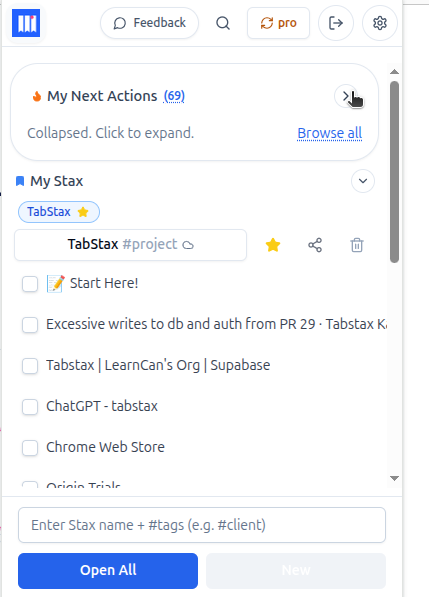
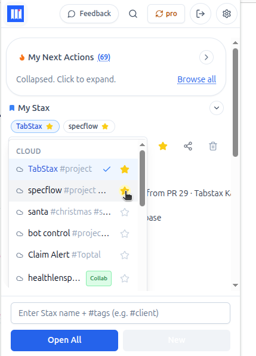

[← Back to Help Home](/)

# Pin the stax that matter now

A favourite puts a stax at the top of the TabStax list, and up to three show as pills you can click.

## Why it helps

Billing week. A launch sprint. You switch between the same three stax all day. Pills keep them one click away, so you stop scrolling a long list.

## Favourite a stax

1. Open the **My Stax** dropdown.
2. Click the stax to expand it.
3. Click the **star** in its header bar.

The stax now shows as a **pill** above your list.

## What you get

| | |
|---|---|
| Pills | Up to 3 above the list. Click one to open that stax. |
| Favourites | As many as you like, starred at the top of the dropdown. |

## Unfavourite

1. Click the stax in the dropdown to expand it.
2. Click the **star** again.

The pill goes, and the stax drops back to its usual spot.

Now you can keep this week's work one click away, and swap it out when the week ends.

**Related:** [The main popup](using_the_main_popup.md) · [Create your first stax](creating_your_first_stax.md) · [What is a stax?](what_is_a_stax.md)
