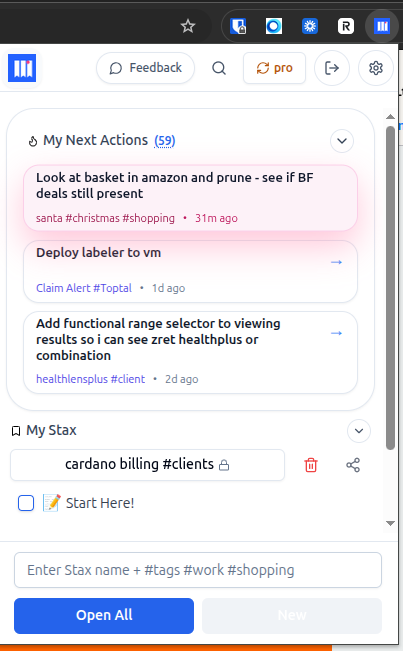
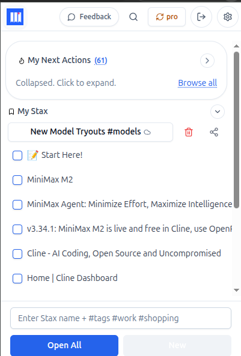

[← Back to Help Home](/)

# Use the TabStax popup

The popup is the TabStax extension's panel in Chrome. It shows your next actions and your stax.

## Why it helps

Two questions eat your morning: "What should I do next?" and "Which project do I open?". The popup answers each in its own section. Glance, pick, go.

The top bar has Search, Feedback, Help and Sign out.

## My Next Actions

Three next actions from across all your stax, newest update first. The most recent one has a soft pink glow: probably what you were just doing. It is a hint, not a rule.

1. Click a next action to open that stax's Start Page. It opens the page, not all the tabs.
2. Click the number beside "My Next Actions" (for example `59`) for the full list.
3. Or collapse the panel and click **Browse all** to see every project and its next actions.

## My Stax

Open and manage whole stax here.

1. Pick a stax from the dropdown, or search by name or tag (`#clients`, `billing`).
2. Click **Open All** to open every tab in it.
3. To save the tabs you have open now, type a name and optional tags (`cardano billing #clients`) and click **New**. More in [Creating your first stax](creating_your_first_stax).

Now you can answer "what next?" in one glance, and open the right stax in one click.

---

**Related guides:**
- [What you see the first time you open TabStax](first_time_opening_tabstax)
- [The HeyStax mental model](tabstax_mental_model)
- [What is a stax?](what_is_a_stax)
